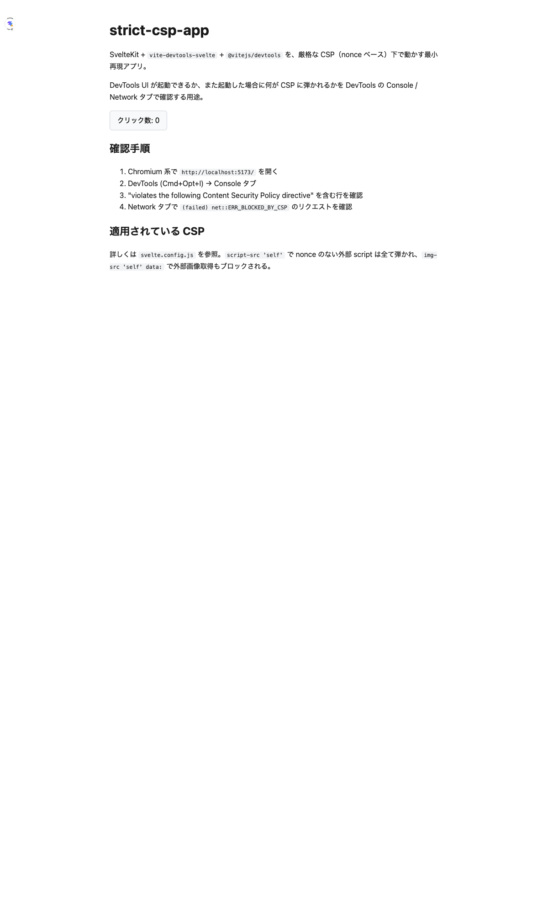

# kit-strict-csp: minimal repro for CSP / SSR

A minimal SvelteKit app to reproduce and measure the behavior around [Issue #51](https://github.com/baseballyama/vite-devtools-svelte/issues/51).

It is built to **hit two traps on purpose**:

1. SvelteKit's strict CSP (nonce based)
2. SvelteKit dev bypassing `transformIndexHtml`

## Start

```bash
pnpm install
pnpm build                 # build the plugin + UI at the repository root
pnpm -C examples/kit-strict-csp dev
```

Open `http://localhost:5173/` and the Vite DevTools icon (the collapsed dock) shows at the top left. Click it to open the dock.



## Results (as of 2026-05-30 / `@vitejs/devtools@0.2.0`)

### ✅ #51-1: the README is missing the `DevTools()` registration

Fixed in [PR #55](https://github.com/baseballyama/vite-devtools-svelte/pull/55).

### ✅ #51-2: SvelteKit needed `import '@vitejs/devtools/client/inject'` (no longer needed)

- Then (`@vitejs/devtools@0.2.0`): `DevTools()` injected its script in `transformIndexHtml`, but SvelteKit dev renders app.html through its own SSR pipeline and skips `transformIndexHtml`, so the dock did not show. The workaround was `import('@vitejs/devtools/client/inject')` in `+layout.svelte` (guarded by `browser`).
- **Now (`@vitejs/devtools` >= 0.7.6): `@vitejs/devtools/client/inject` does not exist** (removed from exports). The workaround import broke the production build with `"./client/inject" is not exported`, so it was removed.
- Instead, SvelteKit (>= 3.3.0, [sveltejs/kit#17787](https://github.com/sveltejs/kit/pull/17787)) adds the dock loader to the page in dev. It is an inline script, but it gets the `kit.csp` nonce, so it works under a strict CSP with `script-src 'self'`.

### ✅ #51-3: WS port in `connect-src`

- The reporter wrote that a connection to `ws://localhost:7812` was blocked by the CSP, but **this check saw no connection to 7812**. The dock rides on Vite's HMR WS (same origin and port as the dev server).
- This app's CSP has `connect-src 'self' ws://localhost:* http://localhost:*`, and the dock talks normally (the network log shows `/__devtools/__connection.json` returning 200).
- 7812 is most likely the behavior of an older `@vitejs/devtools` (the reporter used 0.1.24). **→ No problem with the current version**.

### ⏳ #51-4: CSP violations for `api.iconify.design` / `unocss.dev/logo.svg`

- Not seen on the first load. Most likely they happen when the dock is open and some panel is selected (the reporter's stack trace comes from `DockStandalone-...`, i.e. lazy loading when the standalone UI opens).
- To reproduce, open `/__devtools/` directly and switch between dock entries; that fetches iconify icons.
- The cause is that the `@vitejs/devtools` UI **fetches SVG icons from outside at runtime**, which a strict CSP cannot allow by design. **→ Upstream issue**.

### ✅ #51-5: Vue feature flags warning

- Reproduces reliably as a console.warn:
  > `[warning] Feature flags __VUE_OPTIONS_API__, __VUE_PROD_DEVTOOLS__, __VUE_PROD_HYDRATION_MISMATCH_DETAILS__ are not explicitly defined. ... @ http://localhost:5173/@vite/client:524`
- The `@vitejs/devtools` UI is written in Vue and uses the esm-bundler build.
- **→ A build config issue in `@vitejs/devtools`**. Upstream issue.

### ⏳ #51-6: `Max payload size exceeded` (WebSocket)

- Did not reproduce in a short check. Reported as sporadic.
- Many HMR messages or sending the devtools reactive graph may exceed the WS frame limit.
- **Open a separate issue if it reproduces**.

## CSP-related console errors seen (extra)

`devtoolskit:internal:messages:list from client [0]` returning `Unauthorized` is unrelated to the CSP. It is a bug in the `@vitejs/devtools` RPC authorization (unknown whether the reporter saw it).

## Summary: where each issue belongs

| #   | Where                                                                                     |
| --- | ----------------------------------------------------------------------------------------- |
| 1   | This repository (PR #55)                                                                  |
| 2   | Done: SvelteKit >= 3.3.0 adds the dock (`client/inject` was removed in devtools >= 0.7.6) |
| 3   | Can be closed (does not reproduce with the current version)                               |
| 4   | Upstream (`vitejs/devtools`): the UI fetches external icons at runtime                    |
| 5   | Upstream (`vitejs/devtools`): the Vue feature flags build config                          |
| 6   | Waiting for a repro                                                                       |
